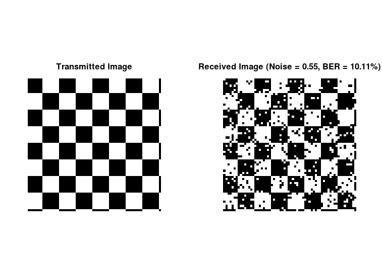
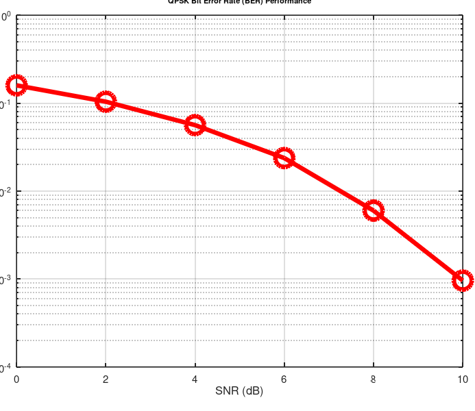

Image error
clear; clc; close all;

% 1. Create a simple test pattern (a 64x64 chessboard image)
img_size = 64;
[X, Y] = meshgrid(1:img_size, 1:img_size);
original_img = mod(floor(X/8) + floor(Y/8), 2); % 1s and 0s matrix

% 2. Flatten the 2D image matrix into a 1D bit stream
tx_bits = original_img(:)';
N_bits = length(tx_bits);

% 3. QPSK Modulation
real_part = (tx_bits(1:2:end) * 2 - 1) / sqrt(2);
imag_part = (tx_bits(2:2:end) * 2 - 1) / sqrt(2);
tx_symbols = real_part + 1i * imag_part;
% 4. Add Noise (Try changing noise_level to 0.2, 0.4, 0.7)
noise_level = 0.55; 
noise = noise_level * (randn(1, N_bits/2) + 1i * randn(1, N_bits/2));
rx_symbols = tx_symbols + noise;

% 5. QPSK Receiver Fences
rx_bit1 = real(rx_symbols) >= 0;
rx_bit2 = imag(rx_symbols) >= 0;

rx_bits = zeros(1, N_bits);
rx_bits(1:2:end) = rx_bit1;
rx_bits(2:2:end) = rx_bit2;

% 6. Reconstruct the image from received bits
received_img = reshape(rx_bits, img_size, img_size);
% 7. Calculate Bit Error Rate
errors = sum(tx_bits ~= rx_bits);
ber = errors / N_bits;

% Display Side-by-Side Comparison
figure;
subplot(1, 2, 1);
imshow(original_img);
title('Transmitted Image');

subplot(1, 2, 2);
imshow(received_img);
title(sprintf('Received Image (Noise = %.2f, BER = %.2f%%)', noise_level, ber*100));\

clear; clc; close all;

% Parameters
N_bits = 100000; % Transmit 100,000 bits for accurate statistical counting
bits = randi([0 1], 1, N_bits);

% Map bits to QPSK symbols
real_part = (bits(1:2:end) * 2 - 1) / sqrt(2);
imag_part = (bits(2:2:end) * 2 - 1) / sqrt(2);
symbols = real_part + 1i * imag_part;

% Define range of SNR values in dB
snr_db_range = 0:2:10; 
ber_results = zeros(1, length(snr_db_range));

for k = 1:length(snr_db_range)
    snr_db = snr_db_range(k);
    
    % Convert SNR from dB to linear noise standard deviation
    snr_linear = 10^(snr_db / 10);
    noise_sigma = 1 / sqrt(2 * snr_linear);
    
    % Add 2D Gaussian noise
    noise = noise_sigma * (randn(1, N_bits/2) + 1i * randn(1, N_bits/2));
 received_symbols = symbols + noise;
    
    % Receiver decision boundaries
    rec_bit1 = real(received_symbols) >= 0;
    rec_bit2 = imag(received_symbols) >= 0;
    
    received_bits = zeros(1, N_bits);
    received_bits(1:2:end) = rec_bit1;
    received_bits(2:2:end) = rec_bit2;
    
    % Compute Bit Error Rate (BER)
    bit_errors = sum(bits ~= received_bits);
    ber_results(k) = bit_errors / N_bits;
end

% Plot BER vs. SNR on a semilogarithmic scale
figure;
semilogy(snr_db_range, ber_results, 'r-o', 'LineWidth', 2, 'MarkerSize', 8);
grid on;
title('QPSK Bit Error Rate (BER) Performance');
xlabel('SNR (dB)');
ylabel('Bit Error Rate (BER)');
axis([0 10 1e-4 1]);

